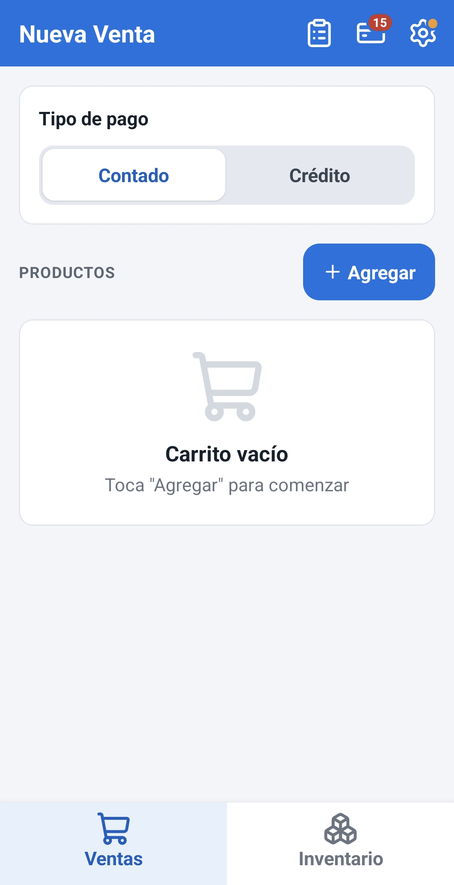
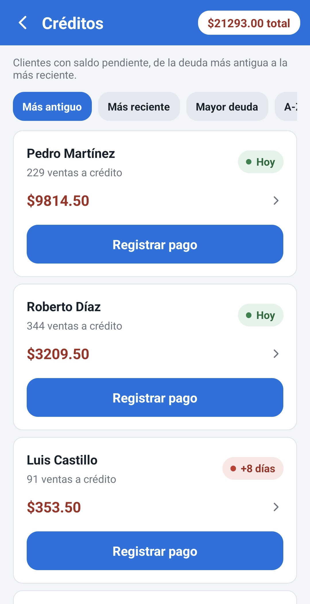
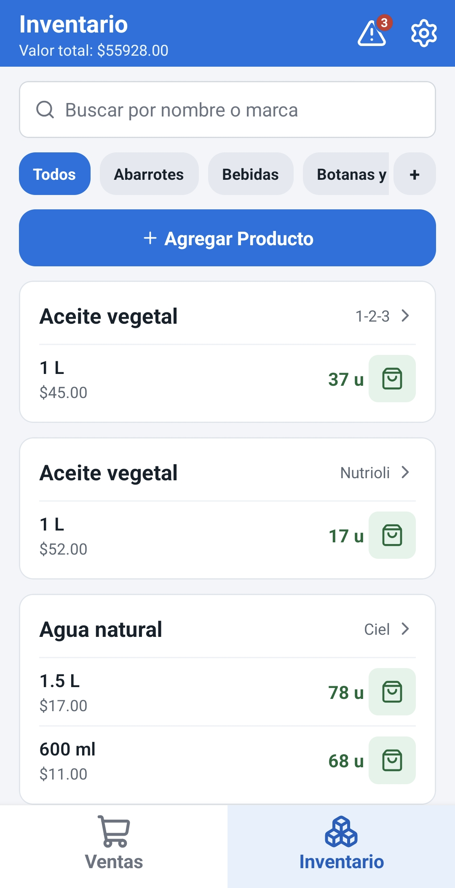
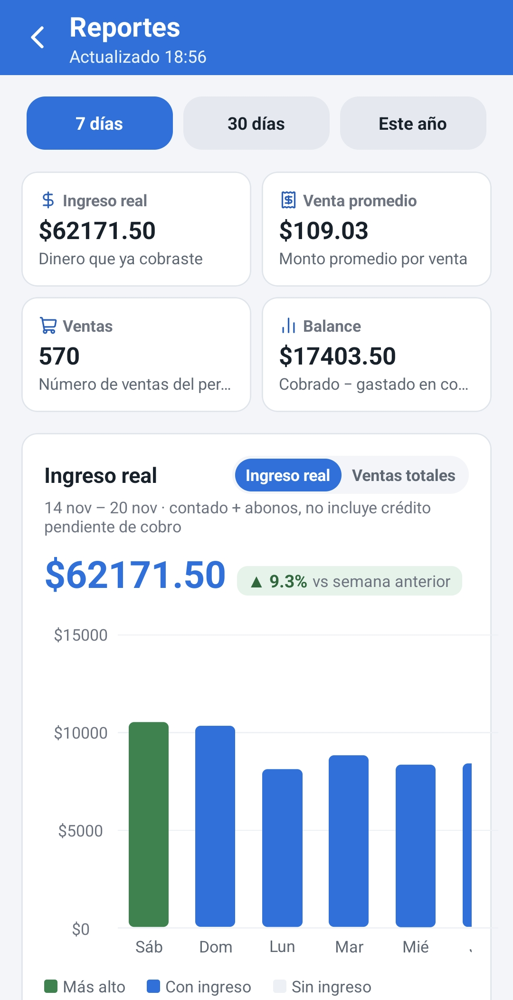
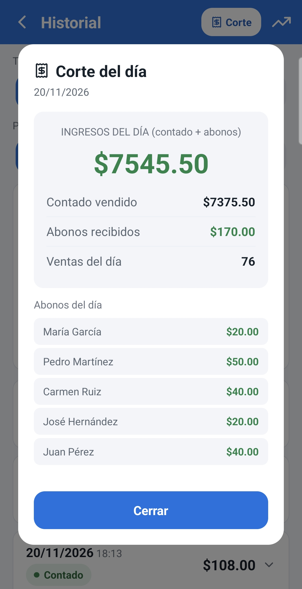
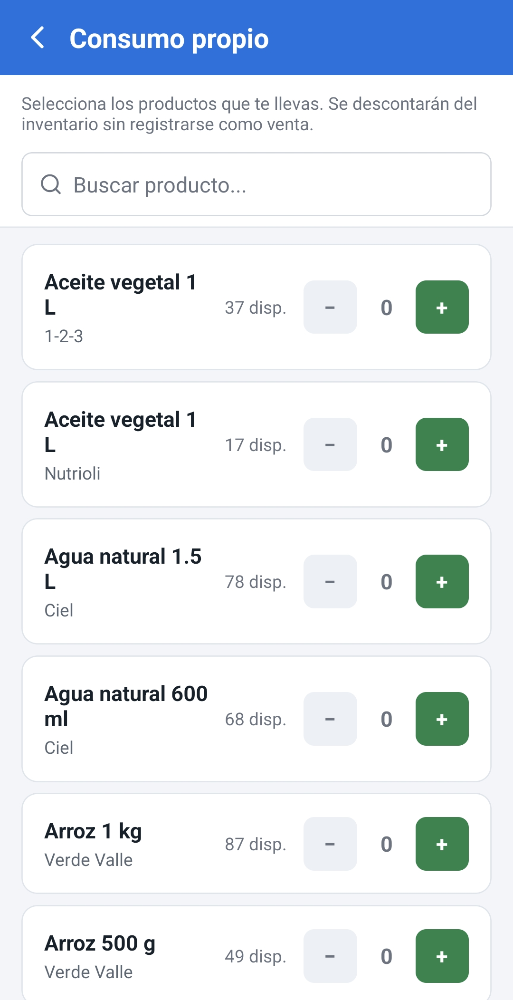
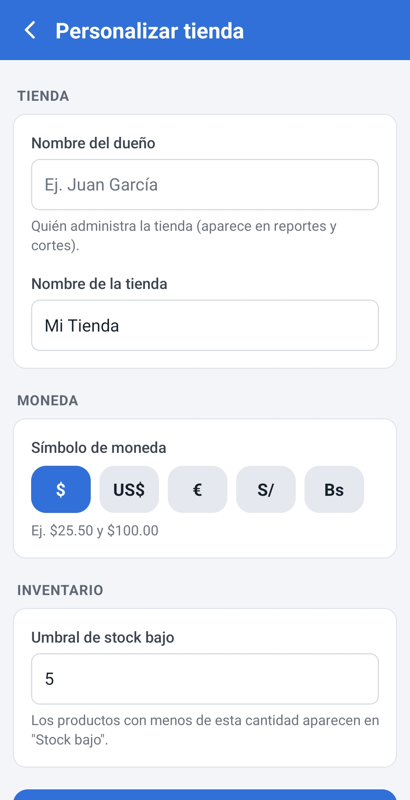
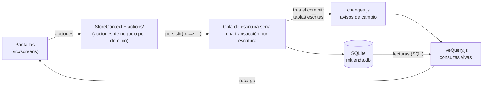

<div align="center">


# LudyShop

**Punto de venta e inventario sin internet para tiendas de abarrotes.**

[English](README.md) · **Español**

[](https://github.com/sosagonzales0409-max/LudyShop/actions/workflows/ci.yml)


Android: **prueba cerrada en Google Play** · iOS: **probada en dispositivo, aún no está en App Store**

</div>

---

## Capturas

<table>
  <tr>
    <td align="center"><br/><sub>Nueva venta (contado o crédito)</sub></td>
    <td align="center"><br/><sub>Clientes que deben</sub></td>
    <td align="center"><br/><sub>Inventario y valor en anaquel</sub></td>
    <td align="center"><br/><sub>Reportes</sub></td>
  </tr>
  <tr>
    <td align="center"><br/><sub>Corte del día</sub></td>
    <td align="center"><br/><sub>Consumo propio</sub></td>
    <td align="center"><br/><sub>Datos de la tienda</sub></td>
    <td></td>
  </tr>
</table>

## El problema

Una tienda de abarrotes casi siempre la atiende una sola persona en el mostrador, muchas veces sin buena conexión a internet. Le fía a los vecinos de confianza, lo anota en una libreta, y se entera de lo que falta en el anaquel cuando un cliente lo pide.

LudyShop lleva la tienda en el teléfono, **sin necesidad de internet**: cobrar sin hacer cuentas, saber quién debe y cuánto, y saber qué hay en el anaquel y qué falta comprar.

## Funciones

- **Ventas** al contado o a crédito, con carrito y productos por pieza o **a granel** (arroz, frijol, etc.).
- **Créditos y abonos**: deuda por cliente, pagos parciales y orden por deuda más antigua o más grande.
- **Inventario**: productos con marca y varias presentaciones, categorías, alertas de stock bajo y valor total del inventario.
- **Compras** a proveedores, que reabastecen el inventario y registran lo gastado.
- **Reportes**: ingreso real (contado + abonos), venta promedio y balance de los últimos 7 días, los últimos 30 días o el año en curso.
- **Corte del día**: dinero cobrado hoy, separado en ventas de contado y abonos.
- **Devoluciones, eliminar ventas y editar compras**, siempre con el inventario consistente.
- **Copias de seguridad**: exportar e importar todos los datos en un archivo.
- **Registro de actividad** de cada acción relevante.

## Tecnologías

| Área | Tecnología |
|---|---|
| App | React Native 0.83, React 19 |
| Base de datos | SQLite con `@op-engineering/op-sqlite` (modo WAL) |
| Navegación | React Navigation 6 (pestañas + stacks nativos) |
| Gráficas | `react-native-gifted-charts` |
| IDs | UUIDv7 (`uuid`) |
| Respaldos | `react-native-fs`, `react-native-share`, selector de documentos |
| Pruebas | Arnés propio en Node.js sobre `node:sqlite` (ver [Calidad](#calidad)) |

## Arquitectura



- **En memoria solo vive lo pequeño** (productos, categorías, clientes, configuración). Ventas, abonos y compras se consultan con SQL cuando se necesitan, así la app sigue rápida con un año de datos.
- **Toda escritura pasa por `persistir()`**, y las pantallas que muestran consultas se recargan solas cuando otra acción escribe en las tablas de las que dependen.

## Decisiones técnicas

Cada decisión resuelve un problema concreto:

| Decisión | Por qué |
|---|---|
| **Offline-first con SQLite** | La tienda no tiene internet confiable. Todos los datos viven en el teléfono y la base de datos es la única fuente de verdad. El modelo de datos está pensado para que una versión futura agregue sincronización en línea sin cambiar cómo funciona sin internet. |
| **Cola de escritura serial** (`persistir`) | Cada escritura corre en su propia transacción, una tras otra. Dos toques rápidos nunca se mezclan ni corrompen datos. La cola además detecta qué tablas tocó cada sentencia y avisa a las pantallas solo después del commit, un punto natural para enviar después los cambios a un servidor. |
| **Inventario como registro de movimientos** | El stock nunca se sobreescribe. Cada cambio (venta, compra, devolución, ajuste, consumo propio) agrega un renglón a `movimientos_inventario`; la columna `stock` es una caché de esa suma, actualizada en la misma transacción. Así queda un historial completo, y deshacer una venta agrega un movimiento contrario en vez de adivinar el valor anterior. También prepara la sincronización en línea: los movimientos de varios dispositivos simplemente se juntan, mientras que dos valores de `stock` distintos chocarían. |
| **Las ventas guardan una foto del producto** | Nombre y precio se copian al vender, así editar o borrar un producto nunca altera el historial ni los reportes. |
| **Lista para sincronizar en línea (V2)** | Todas las tablas de datos tienen id UUIDv7, `tienda_id`, `created_at`/`updated_at` y borrado lógico (`deleted_at`). Los ids se generan sin internet en varios dispositivos sin chocar, `updated_at` decide qué versión gana al combinar, y los borrados se pueden sincronizar en vez de desaparecer. |
| **Migraciones versionadas que no se editan** | La versión del esquema vive en `PRAGMA user_version`. Una migración publicada nunca se cambia; las correcciones van en una nueva, dentro de una transacción (todo o nada) y sin borrar ni fusionar datos del usuario. |
| **Redondeo de dinero y cantidades en un solo lugar** | El granel usa cantidades con decimales; el stock se actualiza con `ROUND(stock + ?, 3)` en SQL y con la misma regla en memoria, así los errores de punto flotante nunca se acumulan. |

## Calidad

Las pruebas unitarias de React Native no pueden correr fácilmente una base SQLite real, así que el proyecto tiene su propio arnés en [`qa/`](qa/):

- **Corre el código real**: `qa/harness/build.mjs` copia la capa de datos y el `StoreContext` reales y sustituye solo los módulos nativos (op-sqlite → `node:sqlite` de Node, React Native → sustitutos).
- **Escenarios de acciones**: siembra un año de datos y ejecuta cada acción de negocio (ventas, crédito, abonos, devoluciones, compras, eliminaciones), revisando stock y saldos después de cada una.
- **Oráculo de dinero**: recalcula cada total esperado en JavaScript a partir de las filas crudas, sin usar el SQL de la app, y lo cruza con las consultas de los reportes.
- **Verificaciones de integridad** ([`qa/integrity.sql`](qa/integrity.sql)): invariantes de la BD, por ejemplo que la caché de stock sea igual a la suma de sus movimientos.

## Estructura del proyecto

```
src/
├── screens/        # Pantallas completas (nueva venta, créditos, inventario, reportes…)
├── modals/         # Modales (pago, devoluciones, corte del día…)
├── ui/             # Piezas de UI reutilizables (encabezado, campos, toast…)
├── navigation/     # Pestañas y stacks nativos
├── context/        # StoreContext (estado y núcleo) + actions/ por dominio
├── config/         # Tema y formato de dinero y cantidades
└── data/
    ├── db.js           # Conexión y cola de escritura persistir()
    ├── migrations.js   # Esquema versionado
    ├── liveQuery.js    # Consultas vivas
    ├── repositories/   # Escrituras por entidad
    ├── queries/        # Lecturas SQL agregadas por pantalla
    └── backup.js       # Exportar e importar copias de seguridad
qa/                 # Arnés de pruebas, oráculo de dinero e integridad
```

Los nombres de archivos y componentes están en inglés; el código, los comentarios y la interfaz, en español, el idioma del negocio.

## Correrla localmente

Requisitos: Node 22+ y la [configuración del entorno de React Native](https://reactnative.dev/docs/set-up-your-environment) para tu plataforma. La app funciona en **Android e iOS**.

```sh
npm install
npm start          # Metro
```

**Android** (Android Studio + emulador o dispositivo), en otra terminal:

```sh
npm run android
```

**iOS** (macOS + Xcode), en otra terminal:

```sh
bundle install                       # solo la primera vez (CocoaPods)
cd ios && bundle exec pod install && cd ..
npm run ios
```

### Pruebas

```sh
npm test       # escenario completo desde una BD vacía + todas las acciones con integridad (~1 min)
npm run lint
```

Las dos corren solas en cada push con [GitHub Actions](.github/workflows/ci.yml).

## Licencia

Copyright © 2025-2026 Luis Alberto Sosa González. **Todos los derechos reservados.**
Este repositorio es público solo como muestra de portafolio. Ver [LICENSE](LICENSE).

## Contacto

**Luis Alberto Sosa González**<br/>
Frontend Developer (React Native + React) · Next.js · TypeScript · Apps en Google Play y App Store

[](https://sosadev.online/)
[](https://www.linkedin.com/in/luis-sosa-reactnative/)
[](https://github.com/sosagonzales0409-max)
[](mailto:sosadevmx@gmail.com)
