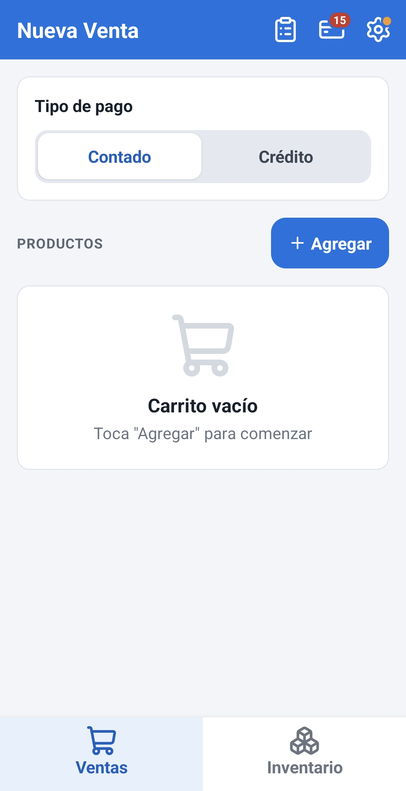
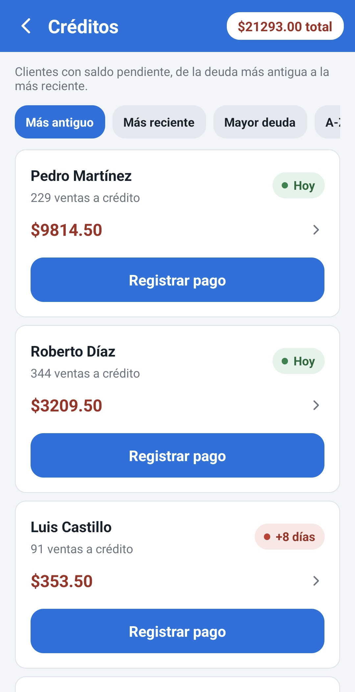
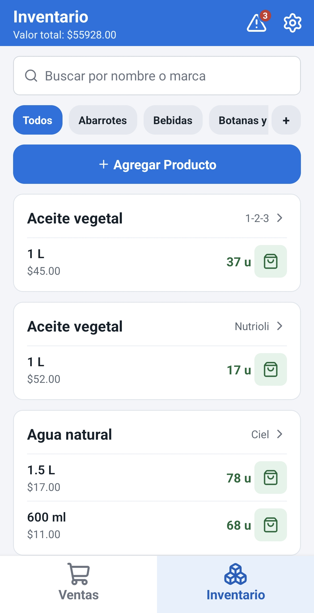
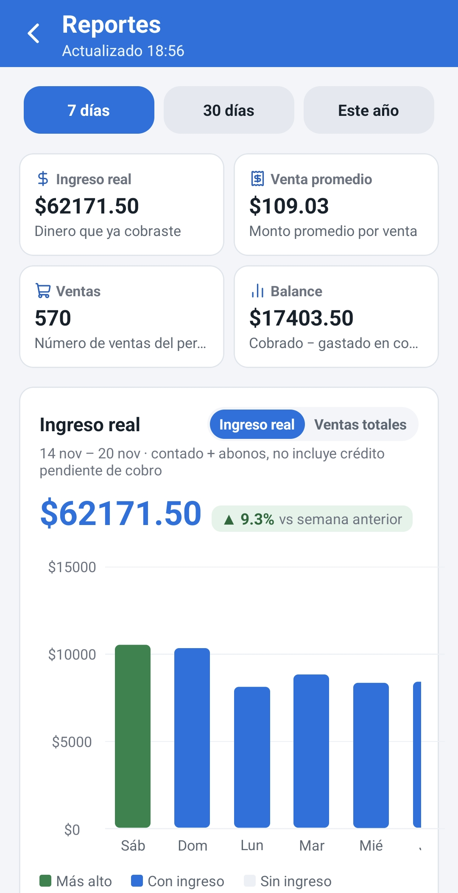
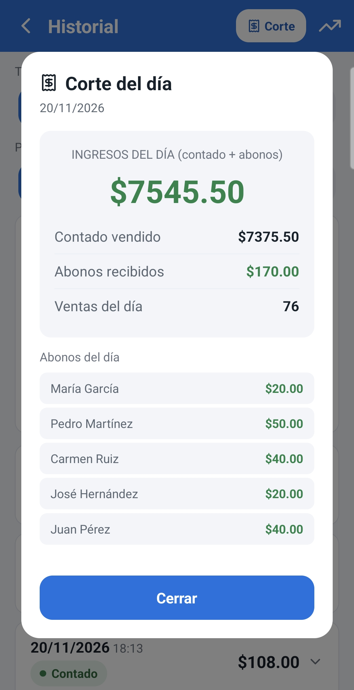
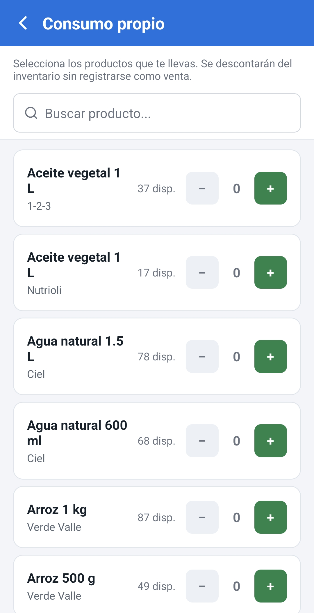
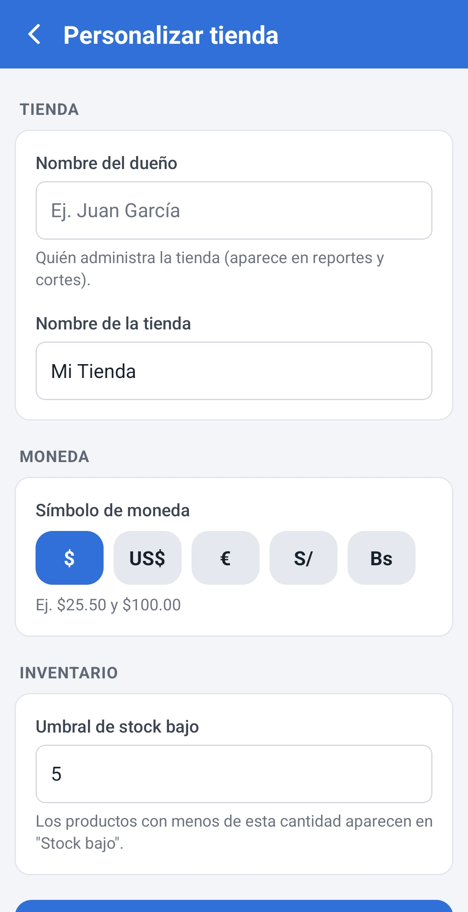
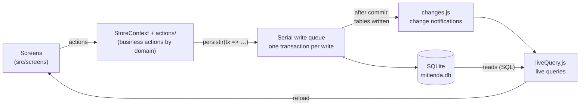

<div align="center">


# LudyShop

**Offline point-of-sale and inventory app for small neighborhood grocery stores.**

**English** · [Español](README.es.md)

[](https://github.com/sosagonzales0409-max/LudyShop/actions/workflows/ci.yml)


Android: **closed testing on Google Play** · iOS: **tested on device, not yet on the App Store**

</div>

---

## Screenshots

<table>
  <tr>
    <td align="center"><br/><sub>New sale (cash or credit)</sub></td>
    <td align="center"><br/><sub>Customers who owe money</sub></td>
    <td align="center"><br/><sub>Inventory and stock value</sub></td>
    <td align="center"><br/><sub>Reports</sub></td>
  </tr>
  <tr>
    <td align="center"><br/><sub>End-of-day cash summary</sub></td>
    <td align="center"><br/><sub>Owner's own consumption</sub></td>
    <td align="center"><br/><sub>Store settings</sub></td>
    <td></td>
  </tr>
</table>

> The app UI is in Spanish: it was built for grocery stores in Mexico.

## The problem

A Mexican *tienda de abarrotes* is usually run by one person behind the counter, often without a reliable internet connection. They sell on credit to neighbors they trust ("fiado"), track it in a paper notebook, and only find out what is missing from the shelf when a customer asks for it.

LudyShop puts the store on the owner's phone, **with no internet required**: charge without doing math, know who owes how much, and know what is in stock and what needs to be bought.

## Features

- **Sales** in cash or on credit, with a cart and products sold by unit or **by weight/volume** (bulk: rice, beans, etc.).
- **Credit and payments**: debt per customer, partial payments, sorting by oldest or largest debt.
- **Inventory**: products with brand and several sizes, categories, low-stock alerts and total inventory value.
- **Purchases** from suppliers, which restock inventory and record what was spent.
- **Reports**: real income (cash + payments received), average sale and balance, by week, month or year.
- **End-of-day summary**: money collected today, split into cash sales and payments.
- **Returns, deleting sales and editing purchases**, always keeping inventory consistent.
- **Backups**: export and import all data as a file.
- **Activity log** of every relevant action.

## Tech stack

| Area | Technology |
|---|---|
| App | React Native 0.83, React 19 |
| Database | SQLite via `@op-engineering/op-sqlite` (WAL mode) |
| Navigation | React Navigation 6 (bottom tabs + native stacks) |
| Charts | `react-native-gifted-charts` |
| IDs | UUIDv7 (`uuid`) |
| Backups | `react-native-fs`, `react-native-share`, document picker |
| Tests | Custom Node.js harness over `node:sqlite` (see [Quality](#quality)) |

## Architecture



- **Memory holds only what is small** (products, categories, customers, settings). Sales, payments and purchases are queried with SQL on demand, so the app stays fast with a year of data.
- **Every write goes through `persistir()`**, and screens that show query results reload themselves when another action writes to the tables they depend on.

## Technical decisions

Each decision solves a concrete problem:

| Decision | Why |
|---|---|
| **Offline-first with SQLite** | The store has no reliable internet. All data lives on the phone; the database is the single source of truth. The data model is designed so a future version can add online sync without changing how the app works offline. |
| **Serial write queue** (`persistir`) | Every write runs in its own transaction, one after another. Two quick taps can never interleave and corrupt data. The queue also detects which tables each statement touched and notifies screens only after the commit, a natural hook for sending changes to a server later. |
| **Inventory as an append-only ledger** | Stock is never overwritten. Each change (sale, purchase, return, adjustment, own consumption) adds a row to `movimientos_inventario`; the `stock` column is a cache of that sum, updated in the same transaction. This gives a full audit trail, and undoing a sale adds an opposite movement instead of guessing the previous value. It also prepares for online sync: movements from several devices can simply be merged, while two different `stock` values would conflict. |
| **Sales keep a snapshot of the product** | Name and price are copied at the time of the sale, so editing or deleting a product never changes past history or reports. |
| **Ready for online sync (v2)** | Every table has a UUIDv7 id, `tienda_id`, `created_at`/`updated_at` and soft delete (`deleted_at`). IDs can be generated offline on several devices without collisions, `updated_at` decides which version wins when merging, and deletions can be synced instead of disappearing. |
| **Versioned migrations that are never edited** | The schema version lives in `PRAGMA user_version`. Once a migration is published it is never changed; fixes go in a new one, run inside a transaction (all or nothing), without deleting or merging user data. |
| **Money and quantities rounded in one place** | Bulk products use decimal quantities; stock is updated with `ROUND(stock + ?, 3)` in SQL and the same rule in memory, so floating-point errors never accumulate. |

## Quality

React Native unit tests can't easily run a real SQLite database, so the project has its own harness in [`qa/`](qa/):

- **Runs the real code**: `qa/harness/build.mjs` copies the actual data layer and `StoreContext` and replaces only the native modules (op-sqlite → Node's built-in `node:sqlite`, React Native → stubs).
- **Action scenarios**: seeds a year of data and runs every business action (sales, credit, payments, returns, purchases, deletions), checking stock and balances after each one.
- **Money oracle**: recomputes every expected total in plain JavaScript from the raw rows, without using the app's SQL, and cross-checks it against the app's report queries.
- **Integrity checks** ([`qa/integrity.sql`](qa/integrity.sql)): database invariants, e.g. the stock cache equals the sum of its movements.

## Project structure

```
src/
├── screens/        # Full screens (new sale, credits, inventory, reports…)
├── modals/         # Modals (payment, returns, end of day…)
├── ui/             # Reusable UI pieces (header, form fields, toast…)
├── navigation/     # Tabs and native stacks
├── context/        # StoreContext (state and core) + actions/ split by domain
├── config/         # Theme and money/quantity formatting
└── data/
    ├── db.js           # Connection and persistir() write queue
    ├── migrations.js   # Versioned schema
    ├── liveQuery.js    # Live queries
    ├── repositories/   # Writes per entity
    ├── queries/        # Aggregated SQL reads per screen
    └── backup.js       # Backup export/import
qa/                 # Test harness, money oracle and integrity checks
```

File and component names are in English; the code, comments and UI are in Spanish, the language of the business domain.

## Running locally

Requirements: Node 22+ and the [React Native environment setup](https://reactnative.dev/docs/set-up-your-environment) for your platform. The app runs on **Android and iOS**.

```sh
npm install
npm start          # Metro
```

**Android** (Android Studio + emulator or device), in another terminal:

```sh
npm run android
```

**iOS** (macOS + Xcode), in another terminal:

```sh
bundle install                       # first time only (CocoaPods)
cd ios && bundle exec pod install && cd ..
npm run ios
```

### Tests

```sh
npm test       # end-to-end scenario from an empty database + every action with integrity checks (~1 min)
npm run lint
```

Both run automatically on every push with [GitHub Actions](.github/workflows/ci.yml).

## License

Copyright © 2025-2026 Luis Alberto Sosa González. **All rights reserved.**
This repository is public only as a portfolio sample. See [LICENSE](LICENSE).

## Contact

**Luis Alberto Sosa González**<br/>
Frontend Developer (React Native + React) · Next.js · TypeScript · Apps on Google Play and the App Store

[](https://sosadev.online/)
[](https://www.linkedin.com/in/luis-sosa-reactnative/)
[](https://github.com/sosagonzales0409-max)
[](mailto:sosadevmx@gmail.com)
